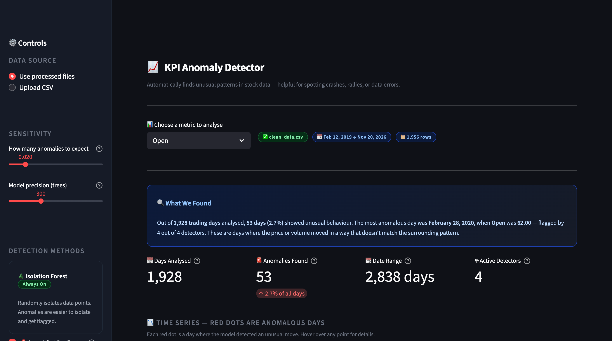

# KPI Anomaly Detector

Unsupervised anomaly detection on AAPL daily data (2019 to present). Five detectors (Isolation Forest, One-Class SVM, LOF, z-score, IQR) vote on which days look unusual. SHAP explains the Isolation Forest flags, and the top-ranked days are checked against a hand-written list of 15 market events. There is a Streamlit dashboard and a small `src/` package.

---

## Results

| Metric | Value |
|---|---|
| Dataset | AAPL, 1,984 trading days, Jan 2019 to 20 Nov 2026 (1,956 after feature building) |
| ADF p-value, raw Close | about 0.94 (non-stationary; 0.9416 to 0.9454 depending on the pull) |
| ADF p-value, log returns | ~0 (stationary) |
| Consensus anomalies (2+ detectors agree) | 50 of 1,956 days (2.56%) |
| Precision@5 | 60% (3 of 5) |
| Precision@10 | 50% (5 of 10) |
| Recall@10 | 33.3% (5 of 15 events) |
| Top SHAP features | `dow` (0.399), `log_return` (0.368), `month` (0.336) |
| Baseline: rank by \|log return\| alone | P@5 60%, P@10 40%, P@20 35% (ensemble: 60%, 50%, 35%) |
| Across seeds 0, 1, 7, 42, 123 | P@5 60% and P@10 50% every time; P@20 30-35%; consensus 49-52 days |
| Stability | 96% day-level agreement between first-half and second-half fits, but only 21% overlap among the days either model flagged |

Ties in vote count are broken by Isolation Forest score. Matches are counted within +/- 1 day of an event date. The data is pulled live from Yahoo Finance, so these numbers come from one run (20 Nov 2026) and will drift as new days arrive. See [Limitations](#limitations) before reading much into them.

---

## Quick Start

```bash
git clone https://github.com/dhwanil1907/kpi-anomaly-detector
cd kpi-anomaly-detector
python -m venv venv
source venv/bin/activate        # macOS/Linux; on Windows: venv\Scripts\activate
pip install -r requirements.txt
streamlit run app.py
```

The dashboard opens on frozen sample AAPL data (`data/raw/aapl_snapshot.csv`), so no upload or network access is needed.

To run the notebook instead, use `jupyter notebook notebook/kpi.ipynb`. It pulls fresh data from yfinance, so its numbers will differ from the Results table.



---

## Detection Models

| Model | Type | Notes |
|---|---|---|
| Isolation Forest | ML | Randomly partitions features; anomalies isolate faster |
| One-Class SVM | ML | Learns boundary of normal; flags anything outside |
| Local Outlier Factor | ML | Compares local density to neighbours |
| Z-Score | Statistical | Flags values > 3σ from mean |
| IQR | Statistical | Flags values outside [Q1−1.5×IQR, Q3+1.5×IQR] |

---

## Features

### Feature Engineering Pipeline
- **Log returns** (`ln(Pₜ/Pₜ₋₁)`) — stationary transformation of raw price
- **Log volume** — reduces skew from extreme trading volume spikes
- **Momentum** — 1-day and 7-day percent change
- **Calendar features** — day-of-week, month

The ML detectors see only these six stationary features (`feature_columns` in `src/features.py`). Lags and rolling stats are still built by `build_features` but are price-level, so they are not fed to the models.

### Model Validation
- **ADF (Augmented Dickey-Fuller) test** — confirms raw price is non-stationary; log returns pass stationarity check
- **Precision@K** — of top-K flagged days, what % match a known market event?
- **Recall@K** — of all known events in the data range, what % did the model catch?
- **15 ground-truth events** including COVID crash (Mar 2020), Fed rate hikes (2022), Yen carry trade unwind (Aug 2024)

### SHAP Explainability
- Global feature importance (mean |SHAP| per feature)
- Per-anomaly explanation: which features drove the flag and in which direction
- SHAP scatter plot: feature value vs SHAP contribution across all days

### Streamlit Dashboard
- Opens on the frozen sample data in `data/raw/aapl_snapshot.csv`; an uploaded CSV can be used instead. It does not fetch from Yahoo Finance itself
- Select any numeric KPI column to analyse
- Severity labels (High / Medium / Low) based on how many detectors agree
- Summary card with the anomaly count and the most anomalous day
- Annotated time-series chart with hover tooltips
- Detector agreement bar chart
- Download anomalies as CSV

---

## Project Structure

```
kpi-anomaly-detector/
│
├── app.py                      # Streamlit dashboard
│
├── src/
│   ├── __init__.py             # Public package API
│   ├── io.py                   # yfinance loader + CSV helpers
│   ├── features.py             # Log returns, lags, rolling, calendar features
│   ├── detect.py               # IsolationForest, OCSVM, LOF, Z-Score, IQR
│   ├── evaluate.py             # Precision@K, Recall@K, known market events
│   ├── explain.py              # SHAP feature importance + anomaly explanations
│   ├── viz.py                  # Plotly time-series + bar chart utilities
│   └── config.py               # YAML/JSON config loader with safe defaults
│
├── notebook/
│   └── kpi.ipynb               # Full EDA → features → detection → SHAP → validation
│
├── configs/
│   └── default.yaml            # Ticker, date range, model hyperparameters
│
├── data/
│   ├── raw/aapl_snapshot.csv   # frozen AAPL OHLCV (committed)
│   └── processed/              # clean_data.csv, anomalies.csv (git-ignored)
│
├── requirements.txt
└── README.md
```

---

## Installation

```bash
git clone https://github.com/dhwanil1907/kpi-anomaly-detector
cd kpi-anomaly-detector

python -m venv venv
source venv/bin/activate        # macOS/Linux
# venv\Scripts\activate         # Windows

pip install -r requirements.txt
```

---

## Running the Dashboard

No notebook run is needed: the dashboard starts on the committed snapshot `data/raw/aapl_snapshot.csv`. Run from the repo root:

```bash
streamlit run app.py
```

Opens at `http://localhost:8501`

---

## Running the Notebook

```bash
cd notebook
jupyter notebook kpi.ipynb
```

Run cells top to bottom. The notebook covers:
1. Environment setup + config
2. Data load from Yahoo Finance (AAPL, 2019–today)
3. ADF stationarity test + log return transformation
4. Feature engineering
5. Anomaly detection (5 models)
6. Detector comparison + consensus voting
7. Model validation: Precision@K and Recall@K vs known events
8. SHAP explainability: feature importance + per-day explanations
9. Save processed outputs (`clean_data.csv`, and `anomalies.csv` with days flagged by any detector)

---

## How It Works

### 1. Data Ingestion
Pulls OHLCV data from Yahoo Finance via `yfinance`.

### 2. Stationarity Check
ADF test confirms raw `Close` price is non-stationary (p > 0.05). Log returns are computed and confirmed stationary (p < 0.05) before being fed to ML models.

### 3. Feature Engineering
Each day gets a feature vector of log return, log volume, 1- and 7-day momentum, and day-of-week and month. Price levels are left out because the ADF test shows they are non-stationary.

### 4. Detection
Five independent methods each produce a binary anomaly flag. Z-score and IQR run on the 1-day % change, not the price level. A day is only marked anomalous if **≥ k detectors agree** (configurable: 1 = sensitive, 2 = balanced, 3 = strict).

### 5. Validation
Top-K flagged days are compared against the 15 dates in `KNOWN_EVENTS` (`src/evaluate.py`). There are no labels, so this is the only check on whether the flags mean anything.

### 6. Explainability
SHAP values from the Isolation Forest attribute each flag to features. `explain_top_anomalies` prints the top three drivers for the most anomalous days.

---

## Configuration

`configs/default.yaml` holds the ticker, start date and Isolation Forest settings, and `src.config.load_config()` reads it. The Streamlit app does not load it yet, so the dashboard uses its own sidebar controls.

---

## Limitations

- **Modest gain over a naive baseline.** Ranking days by absolute log return alone matches the ensemble at K=5 and K=20 and trails it by one hit at K=10 (40% vs 50%). With 15 events, that one hit is within noise. Treat the ensemble as a reasonable ranking, not a proven improvement.
- **Results depend on the data pull.** Yahoo adjusts historical prices, so a fresh pull of the same dates gave One-Class SVM 44 flags, consensus 49, P@5 40%, P@10 30% and R@10 26.7%. The numbers above are for the saved `clean_data.csv`. `configs/default.yaml` fixes the end date, but the prices themselves can still shift.
- **`KNOWN_EVENTS` stops at 2024.** It has no 2025 or 2026 events. They were left out on purpose: adding events after seeing the flags would be tuning on the test set. Flags in those years go unscored.

- **Hand-picked ground truth.** `KNOWN_EVENTS` has 15 dates, and 6 of them are in March 2020. A model that only catches the COVID crash scores well on precision.
- **Small sample.** Recall@10 of 33% is 5 events out of 15, so one more or fewer hit moves it a lot.
- **Close-to-event matching.** A flag counts if it falls within a day of an event, which makes matches easier than an exact-date test.
- **SHAP covers one model.** The explanations are for the Isolation Forest only, not for the consensus vote.
- **Statistical baselines are crude.** Z-score and IQR look at one series (daily % change), so they flag only large single-day moves. IQR flags 97 days and z-score 29, against 40 each for Isolation Forest and LOF and 51 for One-Class SVM.
- **Unstable across periods.** Fitting on different halves of the history gives mostly different flagged days (see Stability above).
- **Calendar features lead the SHAP ranking.** `dow` and `month` rank first and third, which suggests they add noise rather than signal for the Isolation Forest.
- **Fixed contamination.** The ML detectors assume about 2% of days are anomalous, so the count of flags is partly set by that choice.

---

## Tech Stack

`Python` · `scikit-learn` · `yfinance` · `SHAP` · `statsmodels` · `Streamlit` · `Plotly` · `pandas` · `numpy`

---

## Author

**Dhwanil Ranpura**
Machine Learning · Data Science · Python Development
